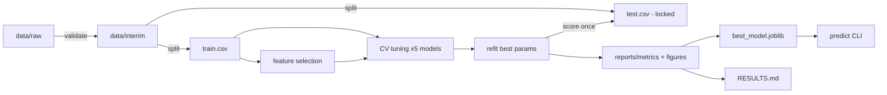

# 05 — Architecture & Repository Layout

## 1. Target layout (created in Phase 0)
```
foodadult/
├── AGENTS.md  SYSTEM_PROMPT.md  CHECKLIST.md  PROGRESS.md  README.md
├── context/                     # specs (this folder) — read-only for agents unless asked
├── docs/                        # original report (.docx/.pdf) + final report drafts
├── configs/
│   └── default.yaml             # ALL tunables: paths, features, target, seed, split, grids
├── data/
│   ├── raw/  interim/  processed/
├── notebooks/
│   └── 01_eda.ipynb             # exploration only; logic must live in src/
├── src/foodadult/
│   ├── __init__.py
│   ├── config.py                # load_config(path) -> dict ; dataclass optional
│   ├── logging_utils.py         # setup_run_dir(), get_logger()
│   ├── data/
│   │   ├── load.py              # load_raw(), standardise_columns(), make_binary_label()
│   │   ├── validate.py          # validate_dataframe(df, cfg) -> ValidationReport
│   │   └── split.py             # stratified_split(df, cfg) -> (train, test); saves split.json
│   ├── features/
│   │   ├── transformers.py      # IQRClipper(BaseEstimator, TransformerMixin)
│   │   ├── preprocess.py        # build_preprocessor(cfg) -> ColumnTransformer
│   │   └── selection.py         # correlation_report(), rf_importance(), perm_importance(), run_rfecv()
│   ├── models/
│   │   ├── registry.py          # get_model(key, cfg), get_search_space(key, cfg)
│   │   ├── train.py             # tune_model(key, X, y, cfg) -> SearchResult ; tune_all()
│   │   └── persist.py           # save_model(), load_model() (+ metadata JSON)
│   ├── evaluation/
│   │   ├── metrics.py           # compute_metrics(y_true, y_pred, y_score) -> dict
│   │   ├── plots.py             # plot_confusion(), plot_roc_overlay(), plot_pr(), plot_importance(), plot_corr()
│   │   └── report.py            # build_results_md(metrics_dir) -> RESULTS.md
│   ├── eda.py                   # run_eda(cfg): summary.json, data_card.md, figures
│   ├── predict.py               # predict_csv(model_path, in_csv, out_csv)
│   └── cli.py                   # argparse entry point
├── models/                      # *.joblib + *_meta.json (gitignored)
├── reports/
│   ├── eda/  features/  metrics/  figures/  runs/
│   └── RESULTS.md
├── tests/
│   ├── conftest.py              # small synthetic fixture df (clearly test-only)
│   ├── test_validate.py  test_transformers.py  test_leakage.py
│   ├── test_metrics.py   test_registry.py      test_predict.py
├── requirements.txt  pyproject.toml  .gitignore
```

## 2. CLI contract (`python -m foodadult.cli <command>`)
| Command | Phase | Does |
|---|---|---|
| `validate --config configs/default.yaml` | 1 | load + validate raw data, write interim CSV |
| `eda --config ...` | 2 | summary.json, data_card.md, EDA figures |
| `split --config ...` | 3 | stratified split → `data/processed/` |
| `select-features --config ...` | 4 | feature ranking + selected_features.json |
| `train --config ... [--models rf svm ...]` | 5–6 | tune models with CV, save per-model results |
| `evaluate --config ...` | 7 | refit best params, score test ONCE, metrics + figures, best_model.joblib |
| `predict --model models/best_model.joblib --input X.csv --output preds.csv` | 10 | batch prediction |
| `report --config ...` | 11 | regenerate `reports/RESULTS.md` from metric files |
| `all --config ...` | 12 | runs validate → report end to end |

## 3. Config skeleton (`configs/default.yaml`)
```yaml
random_state: 42
paths:
  raw: data/raw/TODO_HUMAN_dataset.csv   # set after D-02
  interim: data/interim/clean.csv
  processed_dir: data/processed
  models_dir: models
  reports_dir: reports
data:
  target: label
  positive_label: 1
  features: [ph, density, viscosity, refractive_index, colour_index, moisture_content]  # update after Phase 1
  column_rename: {}          # raw_name: snake_name
  ranges: {ph: [0, 14], moisture_content: [0, 100]}
split: {test_size: 0.2, stratify: true}
preprocess:
  imputer: median
  outliers: clip             # none | clip | drop_train
  iqr_factor: 1.5
  scaler: standard
features:
  corr_threshold: 0.90
  use_selected_subset: false # set after Phase 4 per D-09
cv: {n_splits: 5, shuffle: true, scoring: f1}
class_weight: null           # or balanced (D-07)
models:
  rf:  {grid: {n_estimators: [100, 300, 500], max_depth: [null, 5, 10, 20], min_samples_leaf: [1, 2, 4]}}
  svm: {grid: {C: [0.1, 1, 10, 100], gamma: [scale, 0.001, 0.01, 0.1, 1]}}
  knn: {grid: {n_neighbors: [1,3,5,7,9,11,13,15,17,19,21,23,25,27,29,31], metric: [euclidean, manhattan]}}
  dt:  {grid: {max_depth: [null, 3, 5, 7, 10, 15], min_samples_split: [2, 5, 10, 20]}}
  gb:  {random: {learning_rate: [loguniform, 0.01, 0.3], n_estimators: [randint, 50, 500]}, n_iter: 30}
```

## 4. Data flow


